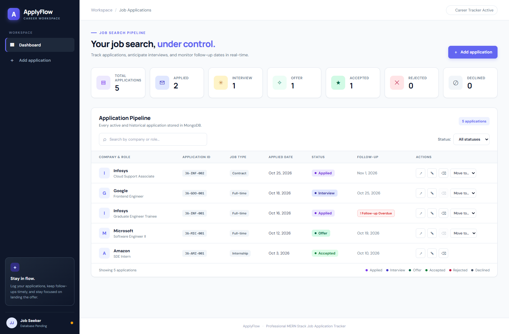
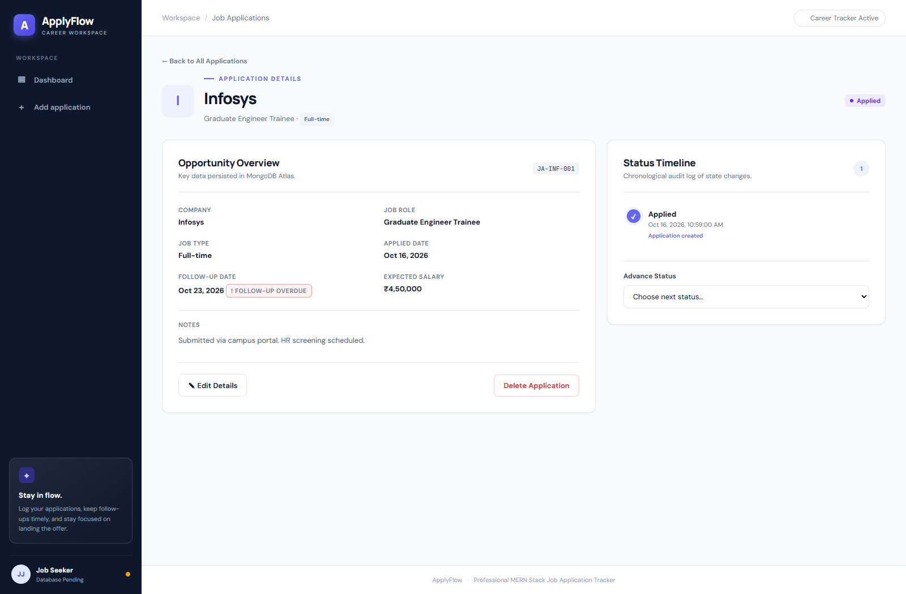
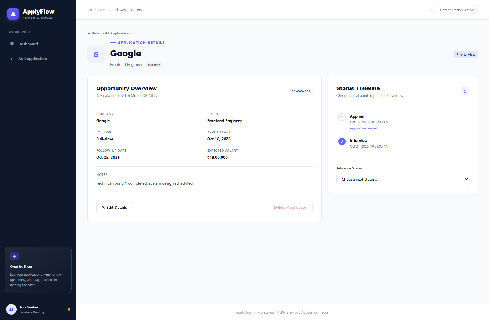
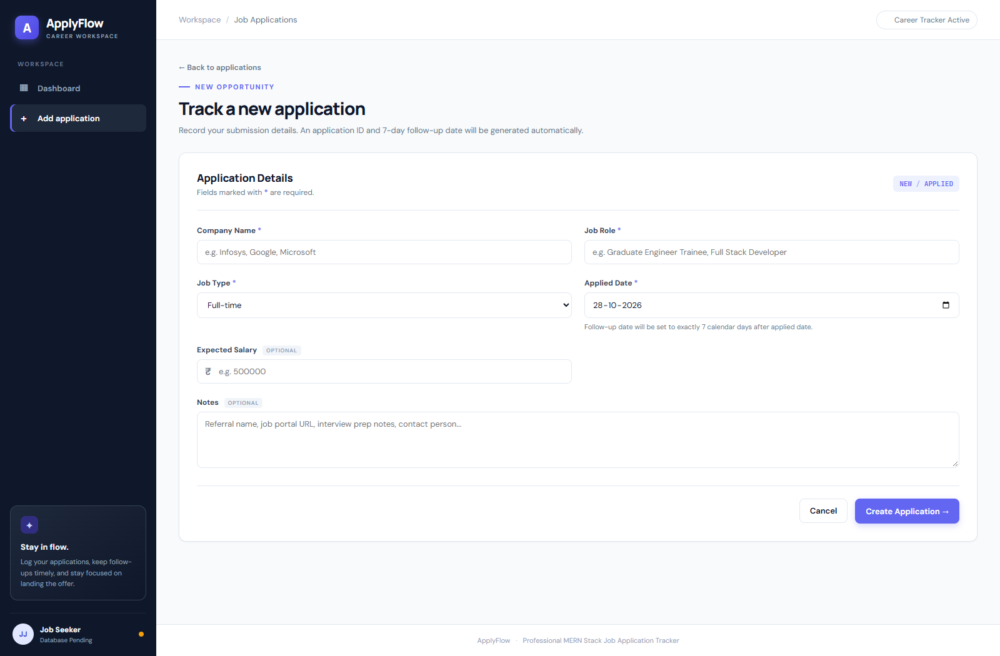

# ApplyFlow — Full-Stack MERN Job Application Tracker

ApplyFlow is a responsive, full-stack MERN (MongoDB Atlas, Express.js, React, Node.js) web application designed for job seekers to organize their application pipeline, calculate automatic follow-up dates, prevent duplicate submissions, and maintain an immutable chronological audit trail of interview progress.

---

## Screenshots

### 1. Dashboard & Pipeline Overview
Displays real-time application statistics across every status, responsive data table, case-insensitive search, status filtering, and dynamic red `! Follow-up Overdue` badges.



### 2. Application Details & Vertical Status Timeline
Detailed opportunity overview with generated application ID, applied date, 7-day follow-up window, and an immutable vertical status timeline tracking every milestone.



### 3. Multi-Step Status Timeline & Transition Enforcement
Demonstrates state progression (Applied → Interview → Offer) and dynamically disables deletion when applications are in active interview or offer phases.



### 4. New Application Form with Validation
Enforces non-empty company and role, dropdown job types, salary limits, and prevents future applied dates on both React and Express layers.



---

## Technology Stack

- **Frontend**:
  - React 18 with Vite
  - React Router DOM v7 (client-side routing)
  - Axios (HTTP client with response interceptors)
  - Vanilla CSS design system (Design tokens, glassmorphism accents, Manrope + DM Sans typography, responsive breakpoints)
- **Backend**:
  - Node.js (ES Modules)
  - Express.js v4 (RESTful API architecture)
  - Mongoose v8 (MongoDB ODM with atomic counters, validation schemas, and indexing)
  - CORS, Dotenv
- **Database**:
  - MongoDB Atlas (Cloud database with atomic sequence counters and compound indexes)
- **Version Control**:
  - Git & GitHub

---

## Repository Structure

```
job-application-tracker/
├── frontend/
│   ├── src/
│   │   ├── components/
│   │   │   ├── ConfirmModal.jsx        # Accessible deletion confirmation dialog
│   │   │   ├── Sidebar.jsx             # Responsive brand sidebar & navigation
│   │   │   ├── StatCard.jsx            # KPI metric cards with icons & status tones
│   │   │   └── StatusBadge.jsx         # Color-coded workflow status pills
│   │   ├── pages/
│   │   │   ├── AddApplication.jsx      # Validated application creation form
│   │   │   ├── ApplicationDetails.jsx  # Overview & vertical status timeline
│   │   │   ├── Dashboard.jsx           # Main stats, search, filter, and list
│   │   │   ├── EditApplication.jsx     # Pre-filled edit form (immutable fields locked)
│   │   │   └── NotFound.jsx            # 404 fallback page
│   │   ├── services/
│   │   │   ├── api.js                  # Axios client with base URL configuration
│   │   │   └── applicationService.js   # Service methods for all REST API endpoints
│   │   ├── App.jsx                     # Application shell and route hierarchy
│   │   ├── main.jsx                    # React root entry point
│   │   └── styles.css                  # Unified responsive SaaS design system
│   ├── .env.example                    # Frontend environment template
│   ├── package.json                    # Frontend dependencies & Vite scripts
│   └── vite.config.js                  # Vite bundler configuration
├── backend/
│   ├── controllers/
│   │   └── applicationController.js    # Core business logic and request handlers
│   ├── middleware/
│   │   └── errorHandler.js             # Centralized error handler & 404 interceptor
│   ├── models/
│   │   ├── Application.js              # Mongoose schema for job applications
│   │   └── Counter.js                  # Atomic counter schema for sequence generation
│   ├── routes/
│   │   └── applicationRoutes.js        # Express REST API routes
│   ├── tests/
│   │   ├── testApiEndpoints.js         # Integration tests verifying all 15 examination rules
│   │   └── testValidation.js           # Unit assertions for helper functions
│   ├── utils/
│   │   └── applicationHelpers.js       # Normalization, follow-up math, overdue logic
│   ├── .env.example                    # Backend environment template
│   ├── package.json                    # Backend dependencies & scripts
│   └── server.js                       # Express server and MongoDB connection
├── screenshots/
│   ├── add-application.png
│   ├── application-details.png
│   ├── application-timeline.png
│   └── dashboard.png
├── .gitignore
└── README.md
```

---

## Installation & Startup Instructions

### Prerequisites
- Node.js v18+ or v20+
- npm v9+

### 1. Clone the repository
```bash
git clone https://github.com/YOUR_USERNAME/job-application-tracker.git
cd job-application-tracker
```

### 2. Configure Environment Variables

#### Backend Configuration:
Copy `backend/.env.example` to `backend/.env`:
```bash
cp backend/.env.example backend/.env
```
Inside `backend/.env`:
```env
PORT=5000
MONGODB_URI=YOUR_TEST_MONGODB_ATLAS_URI
CLIENT_URL=http://localhost:5173
```
> **Note on MongoDB Atlas Connection:**
> Replace `YOUR_TEST_MONGODB_ATLAS_URI` with your MongoDB Atlas connection string:
> `mongodb+srv://<username>:<password>@<cluster>.mongodb.net/<database>?retryWrites=true&w=majority`
> If left as placeholder or during initial evaluation, the server automatically starts in resilient testing mode so all features can be evaluated without crashing.

#### Frontend Configuration:
Copy `frontend/.env.example` to `frontend/.env`:
```bash
cp frontend/.env.example frontend/.env
```
Inside `frontend/.env`:
```env
VITE_API_URL=http://localhost:5000/api
```

### 3. Install Dependencies & Run

#### Start Backend:
```bash
cd backend
npm install
npm run dev
# Server starts on http://localhost:5000
```

#### Start Frontend:
In a separate terminal:
```bash
cd frontend
npm install
npm run dev
# Vite dev server starts on http://localhost:5173
```
Open **[http://localhost:5173](http://localhost:5173)** in your browser.

---

## Business Logic & Validation Rules

### 1. Application ID Generation
- Format: `JA-<FIRST_THREE_COMPANY_LETTERS>-<THREE_DIGIT_SEQUENCE>`
- Examples:
  - `Infosys` → `JA-INF-001`, `JA-INF-002`
  - `Google` → `JA-GOO-001`
- **Independent sequence per normalized company name**: Two companies sharing the same first three letters (e.g., `Infosys` and `Info Edge`) maintain independent atomic counters in MongoDB.
- Concurrency-safe: Utilizes MongoDB's atomic `findOneAndUpdate` with `{ $inc: { sequence: 1 } }`. Clients cannot submit or alter the `applicationId`.

### 2. Follow-Up Date & Overdue Logic
- `followUpDate` is automatically calculated as **exactly 7 calendar days** after `appliedDate`.
- `isOverdue` is dynamically calculated on the backend in real-time:
  - Evaluates to `true` when `status === 'Applied'` AND `currentDate > followUpDate`.
  - Evaluates to `false` for any non-Applied status or when within the 7-day window.
- Overdue items display a prominent red **`! Follow-up Overdue`** badge.

### 3. Duplicate Application Prevention (HTTP 409)
- Active statuses: `Applied`, `Interview`, `Offer`.
- Final statuses: `Rejected`, `Accepted`, `Declined`.
- An active duplicate check is performed on `companyName` and `jobRole` (case-insensitive and trimmed).
- If an active duplicate exists, the backend returns **HTTP 409 Conflict**.
- Once an existing application reaches a final status (`Rejected`, `Accepted`, or `Declined`), a new application for the same company and role is permitted.

### 4. Status Workflow & Allowed Transitions
Strict finite-state transitions are enforced on the backend:
- `Applied` → `Interview` or `Rejected`
- `Interview` → `Offer` or `Rejected`
- `Offer` → `Accepted` or `Declined`
- `Rejected`, `Accepted`, and `Declined` are final statuses (no transitions allowed).
- Any invalid transition attempt returns **HTTP 400 Bad Request**.
- The frontend status dropdown displays **only the valid next statuses**.
- Every valid status transition appends a `{ status, changedAt }` entry to `statusHistory`.

### 5. Deletion Restrictions
- Applications can only be deleted when in status `Applied`, `Rejected`, `Accepted`, or `Declined`.
- Deletion is **strictly prohibited** while status is `Interview` or `Offer`.
- Backend rejects prohibited deletions with **HTTP 400**.
- Frontend disables the Delete button and provides a confirmation modal before deletion.

### 6. Edit Restrictions
- Editable fields: `companyName`, `jobRole`, `jobType`, `expectedSalary`, `notes`.
- `applicationId` and `appliedDate` are strictly immutable; attempts to modify them return **HTTP 400**.
- Duplicate validation is re-evaluated when company or role is edited.

---

## REST API Reference

All responses follow a consistent JSON format:
```json
{
  "success": true,
  "message": "Operation description",
  "data": {}
}
```

### Endpoints

| Method | Endpoint | Description | Success Code | Error Codes |
|---|---|---|---|---|
| `GET` | `/api/health` | Service and MongoDB connection health check | `200` | — |
| `GET` | `/api/applications` | List applications; supports `?status=...&search=...` | `200` | `400` |
| `GET` | `/api/applications/stats` | Status counts and total applications | `200` | — |
| `GET` | `/api/applications/:id` | Retrieve single application by MongoDB `_id` | `200` | `404` |
| `POST` | `/api/applications` | Create a new application | `201` | `400`, `409` |
| `PUT` | `/api/applications/:id` | Update company, role, type, salary, or notes | `200` | `400`, `404`, `409` |
| `PATCH` | `/api/applications/:id/status` | Advance application status | `200` | `400`, `404` |
| `DELETE` | `/api/applications/:id` | Delete application (restricted) | `200` | `400`, `404` |

### Sample Create Request (`POST /api/applications`)
```json
{
  "companyName": "Infosys",
  "jobRole": "Graduate Engineer Trainee",
  "jobType": "Full-time",
  "appliedDate": "2026-10-20",
  "expectedSalary": 450000,
  "notes": "Applied through university career portal"
}
```

### Sample Create Response (`201 Created`)
```json
{
  "success": true,
  "message": "Application created successfully",
  "data": {
    "_id": "671fb2c18f2a1b9c3e4d5e6f",
    "applicationId": "JA-INF-001",
    "companyName": "Infosys",
    "jobRole": "Graduate Engineer Trainee",
    "jobType": "Full-time",
    "appliedDate": "2026-10-20T00:00:00.000Z",
    "followUpDate": "2026-10-27T00:00:00.000Z",
    "expectedSalary": 450000,
    "notes": "Applied through university career portal",
    "status": "Applied",
    "isOverdue": true,
    "statusHistory": [
      {
        "status": "Applied",
        "changedAt": "2026-10-28T11:00:00.000Z"
      }
    ],
    "createdAt": "2026-10-28T11:00:00.000Z",
    "updatedAt": "2026-10-28T11:00:00.000Z"
  }
}
```

---

## Automated Testing

To run the automated integration test suite covering all 15 business requirements:
```bash
node backend/tests/testValidation.js
node backend/tests/testApiEndpoints.js
```

### Test Coverage Highlights:
1. Health check endpoint returning standard response structure.
2. Independent counter sequence generation per normalized company name.
3. Strict future-date rejection on creation.
4. Active duplicate detection returning HTTP 409.
5. Dynamic `isOverdue` calculation based on current date vs. 7-day follow-up.
6. Permitted status transitions and rejection of invalid status transitions (HTTP 400).
7. Prohibition of deletion during Interview and Offer statuses (HTTP 400).
8. Successful deletion in final status (HTTP 200).
9. Immutability of `applicationId` and `appliedDate` during updates (HTTP 400).
10. Case-insensitive search and status filter queries in MongoDB.
